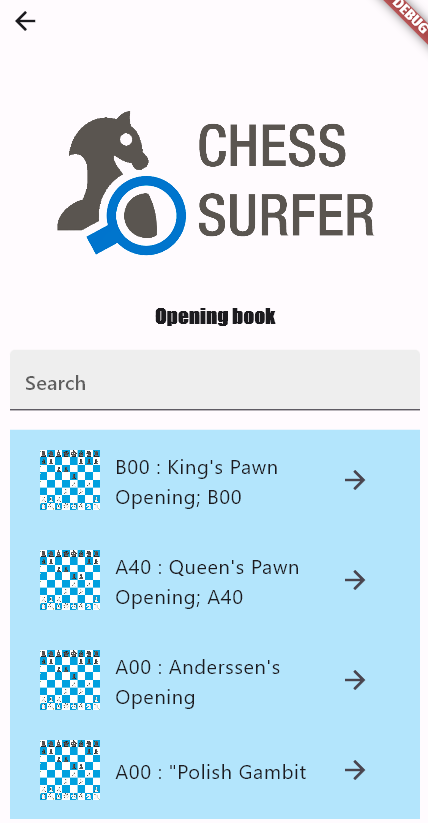
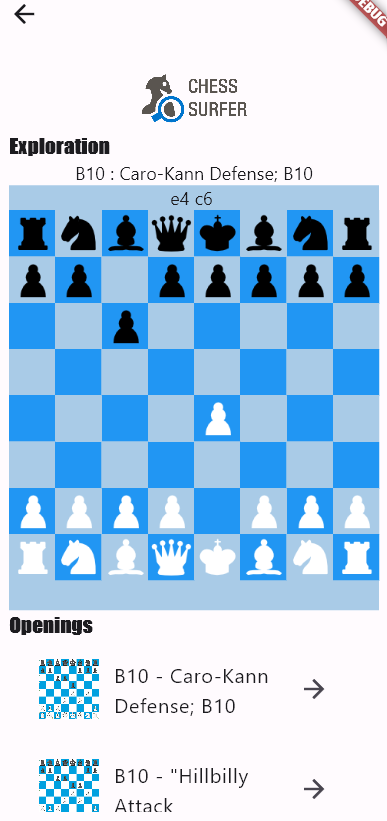
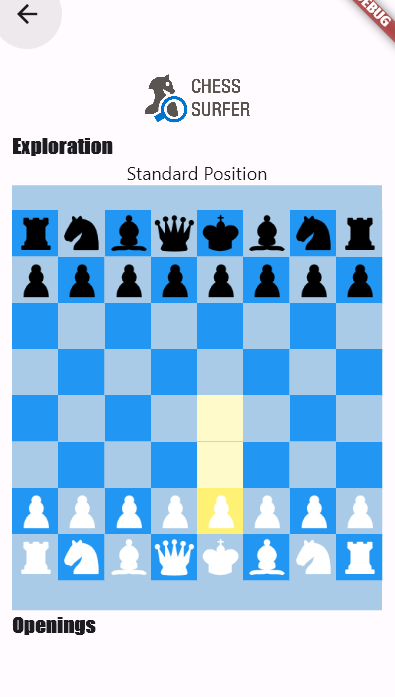
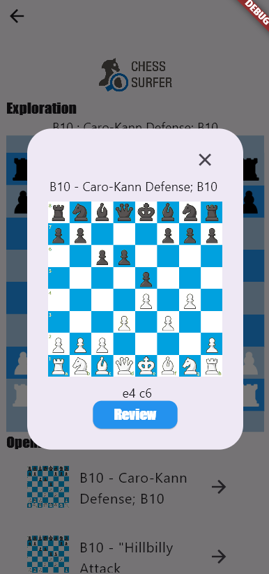
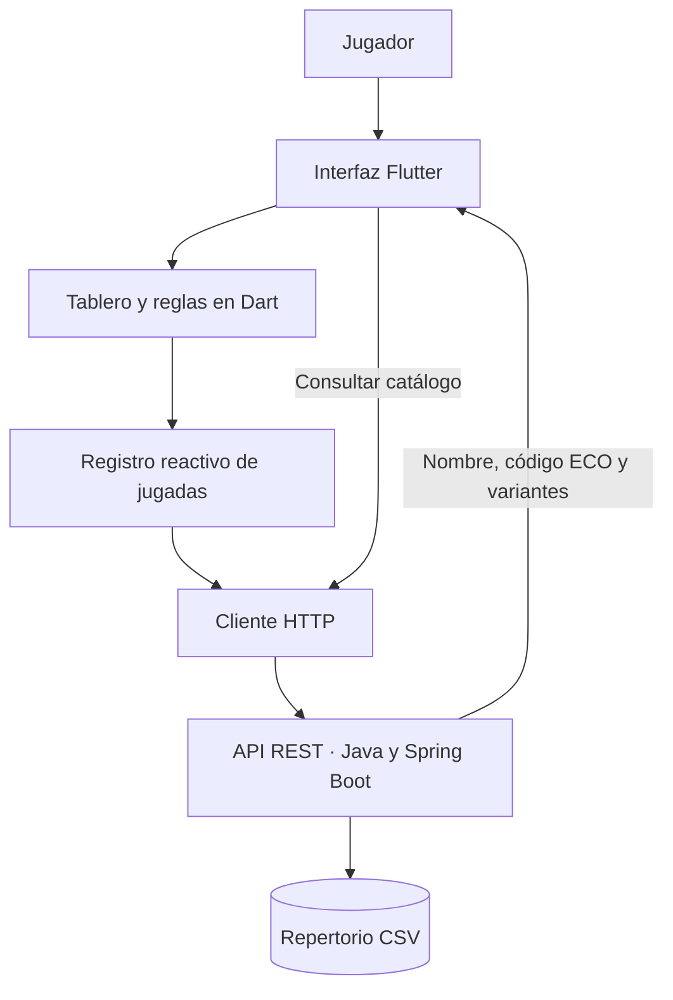

<p align="center">
  
</p>

<h1 align="center">Chess Surfer</h1>

<p align="center">
  <strong>Descubre las aperturas de ajedrez, una jugada a la vez.</strong><br>
  Un explorador de aperturas con tablero interactivo, repertorio y consulta de variantes.
</p>

<p align="center">
  <strong>Flutter · Dart · Java · Spring Boot</strong><br>
  Versión 1
</p>


## La idea

Una secuencia como `e4 c6` tiene un nombre, una familia y muchas posibilidades por explorar. **Chess Surfer conecta las jugadas que haces en el tablero con el repertorio de aperturas que hay detrás de ellas.**

La propuesta es acercar el estudio de aperturas a una experiencia visual: mover una pieza, descubrir qué apertura estás jugando y consultar otras líneas de su familia. Está pensada para jugadores curiosos, personas que empiezan a estudiar teoría y quienes quieren reconocer los nombres de las posiciones que aparecen en sus partidas.

El diseño gira alrededor de tres espacios: **Inicio**, para elegir cómo explorar; **Explore**, para descubrir desde el tablero; y **Openings**, para recorrer el libro de aperturas. La visión es que ambos recorridos se conecten: encontrar una línea en el catálogo y poder estudiarla jugada a jugada sobre el tablero.

## La app en imágenes

<table>
  <tr>
    <th>Inicio</th>
    <th>Libro de aperturas</th>
    <th>Exploración</th>
  </tr>
  <tr>
    <td align="center"></td>
    <td align="center"></td>
    <td align="center"></td>
  </tr>
</table>

<table>
  <tr>
    <th>Selecciona y mueve</th>
    <th>Consulta una apertura</th>
  </tr>
  <tr>
    <td align="center"></td>
    <td align="center"></td>
  </tr>
</table>

## Funcionalidades

### Explorar desde el tablero

En **Explore**, la partida comienza en la posición inicial. Puedes seleccionar una pieza, ver los destinos que calcula el tablero y hacer una jugada pulsando sobre una casilla resaltada.

- Tablero de **8 × 8** con piezas blancas y negras.
- Selección visual y resaltado de destinos.
- Alternancia de turnos y movimientos básicos de las seis clases de piezas.
- Capturas y comprobaciones de jaque y mate.
- Registro visible de las jugadas realizadas.

El tablero está implementado en Dart. Cada movimiento actualiza el registro y provoca nuevas consultas de aperturas, sin tener que abandonar la pantalla. 
### Identificar la apertura que estás jugando

La app consulta la secuencia de movimientos en su repertorio y muestra el código ECO y el nombre cuando encuentra una coincidencia.

Por ejemplo:

```text
Posición inicial       → Standard Position
1. e4                  → B00 · King's Pawn Opening
1. e4 c6               → B10 · Caro-Kann Defense
Secuencia sin registro → Unidentified position
```

### Descubrir variantes relacionadas

Debajo del tablero aparece una lista de líneas asociadas a la apertura encontrada. Cada entrada permite abrir un diálogo con su nombre, código y secuencia de movimientos.

La relación entre aperturas se obtiene mediante su **código ECO**, una clasificación habitual en los repertorios de ajedrez. La búsqueda actual devuelve la coincidencia y las filas consecutivas posteriores con ese código en el dataset; no calcula la mejor jugada ni evalúa la posición.

### Recorrer el libro de aperturas

**Openings** ofrece otra forma de entrar al repertorio: consultar nombres y códigos antes de jugar sobre el tablero.

- Lista de aperturas obtenida desde la API.
- Código ECO y nombre de cada entrada.
- Diálogo con la secuencia de jugadas e imagen de referencia.
- Acceso a la pantalla de exploración mediante **Review**.

El dataset contiene **2.727 registros de aperturas**. La versión actual del endpoint del catálogo entrega hasta **199 registros**. El campo **Search** y la reproducción automática de la línea seleccionada están pendientes de implementación.

## Un recorrido de ejemplo

1. Abre **Explore** desde el inicio.
2. Selecciona el peón blanco de `e2` y muévelo a `e4`.
3. Mueve el peón negro de `c7` a `c6`.
4. Consulta el nombre **Caro-Kann Defense**, con código **B10**, sobre el tablero.
5. Abre una de las entradas de la lista inferior para consultar sus movimientos.
6. Regresa al tablero y continúa explorando nuevas secuencias.

También puedes abrir **Openings** desde el inicio y recorrer el catálogo. Actualmente, **Review** navega a la exploración; la carga de la apertura elegida en el tablero forma parte de la hoja de ruta.

## Arquitectura



**Flutter** construye las pantallas y ejecuta la lógica del tablero. Un `ValueNotifier<String>` comparte el registro de movimientos con los widgets que presentan los resultados. Las consultas HTTP se resuelven de forma asíncrona con `FutureBuilder`.

**Java y Spring Boot** exponen las operaciones de consulta y transforman los registros del CSV en respuestas de la API. La implementación actual lee un archivo local; no necesita un servicio de base de datos para estas consultas.


### Tecnologías

| Componente | Tecnologías y responsabilidades |
| --- | --- |
| Interfaz | Flutter, Dart y Material: navegación, tablero, listas y diálogos |
| Estado reactivo | `StatefulWidget`, `setState` y `ValueNotifier` |
| Integración | Paquete `http`, consultas GET y deserialización JSON |
| Servicio | Java, Spring Boot y Spring Web: endpoints REST y modelo de apertura |
| Datos | CSV con clasificación ECO y secuencias de jugadas |

## Organización del repositorio

```text
.
├── FlutterYDart/FlutterYDart/
│   ├── pubspec.yaml                 # Dependencias y registro de assets
│   └── lib/
│       ├── main.dart                # Entrada de la aplicación e inicio
│       ├── explore_screen.dart      # Exploración y consultas por historial
│       ├── book_screen.dart         # Catálogo y detalles de aperturas
│       ├── chess_log_provider.dart  # Notificador del historial
│       ├── log.dart                 # Instancia compartida del historial
│       ├── board_stuff/             # Estado, movimientos y widgets del tablero
│       └── assets/images/           # Piezas, identidad visual e imágenes de referencia
├── Java/
│   ├── DemoApplication.java         # Entrada de Spring Boot
│   └── services/
│       ├── ServicioRestApplication.java
│       ├── Opening.java             # Modelo de respuesta
│       ├── OpeningSheet.java        # Utilidad de consulta por consola
│       ├── Variant.java             # Modelo auxiliar
│       └── openings_sheet.csv       # Catálogo de aperturas
├── Tarea3_FrontEnd.pdf               # Memoria del proyecto y capturas de pantalla
└── README.md
```

## Ejecución local

El repositorio conserva el código fuente de la entrega académica: `lib/` y `pubspec.yaml` del cliente, junto con las fuentes Java y el catálogo. Para ejecutarlo, hay que incorporarlos a proyectos Flutter y Spring Boot con sus archivos de compilación y plataforma.

### Requisitos

- Flutter con un SDK de Dart compatible con `>=3.2.5 <4.0.0`, según `pubspec.yaml`.
- JDK y Maven compatibles con la versión de Spring Boot elegida para reconstruir el servicio.
- Un dispositivo o plataforma de escritorio configurados para Flutter.

### 1. Preparar el backend

Crea un proyecto Maven de Spring Boot con la dependencia **Spring Web** y el paquete base `op_surfer.demo`. Guárdalo como `chess-surfer-api` en la raíz del repositorio.

Copia las fuentes y el catálogo respetando su estructura de paquetes. Desde la raíz del repositorio:

```bash
mkdir -p chess-surfer-api/src/main/java/op_surfer/demo/services
cp Java/DemoApplication.java chess-surfer-api/src/main/java/op_surfer/demo/
cp Java/services/*.java chess-surfer-api/src/main/java/op_surfer/demo/services/
cp Java/services/openings_sheet.csv chess-surfer-api/src/main/java/op_surfer/demo/services/
```

Inicia el servicio desde la raíz del proyecto generado:

```bash
cd chess-surfer-api
./mvnw spring-boot:run
```

El cliente utiliza `http://localhost:8080`. El controlador espera el CSV en `src/main/java/op_surfer/demo/services/openings_sheet.csv`, relativo al directorio desde el que se ejecuta el backend.

### 2. Preparar el cliente

En otra terminal, desde la raíz del repositorio, genera el proyecto Flutter con el nombre de paquete utilizado por los imports:

```bash
flutter create --project-name chess_face chess-surfer-client
cp -R FlutterYDart/FlutterYDart/lib/. chess-surfer-client/lib/
cp FlutterYDart/FlutterYDart/pubspec.yaml chess-surfer-client/pubspec.yaml
cd chess-surfer-client
flutter pub get
flutter run
```

Si el cliente se ejecuta en un emulador o dispositivo físico, sustituye `localhost` por la dirección del equipo que ejecuta el backend en `explore_screen.dart` y `book_screen.dart`. Ajusta también la configuración de red de la plataforma para permitir las solicitudes HTTP al servicio local.

## API REST

Dirección utilizada por el cliente: `http://localhost:8080`.

| Método | Ruta | Respuesta |
| --- | --- | --- |
| `GET` | `/aperturas` | Lista JSON de hasta 199 aperturas del catálogo |
| `GET` | `/buscarlinea?log=e4_c6_` | Texto con el código ECO y el nombre de la línea, si existe coincidencia |
| `GET` | `/variantes?log=e4_c6_` | Lista JSON de registros relacionados con el ECO de la línea |
| `GET` | `/holamundo?nombre=Chess` | Saludo de comprobación del servicio |

El parámetro `log` separa las jugadas con guiones bajos e incluye un guion bajo final: `e4_c6_`. El servicio lo transforma en una secuencia con espacios y busca una coincidencia exacta en el catálogo.

```bash
curl 'http://localhost:8080/buscarlinea?log=e4_c6_'
curl 'http://localhost:8080/variantes?log=e4_c6_'
curl 'http://localhost:8080/aperturas'
```

Los elementos de las respuestas JSON tienen esta estructura:

```json
{
  "eco": "B10",
  "name": "Caro-Kann Defense; B10",
  "log": "e4 c6"
}
```

## Alcance de la versión

Chess Surfer es un prototipo académico centrado en la interacción con el tablero y la consulta de aperturas. El reconocimiento depende del historial exacto de jugadas; la notación generada es simplificada y no cubre toda la notación algebraica estándar ni las transposiciones. La selección de variantes depende del orden de los registros en el CSV.

El tablero implementa un subconjunto de las reglas: el enroque, la captura al paso, la promoción y las tablas quedan fuera de esta versión. El campo de búsqueda del catálogo es visual, las imágenes de detalle son referencias estáticas y el acceso desde una apertura al tablero inicia una exploración desde la posición inicial.

## Autor y contexto

**Atik J. Santellán** · Programación Avanzada de Aplicaciones · Mayo de 2024.
